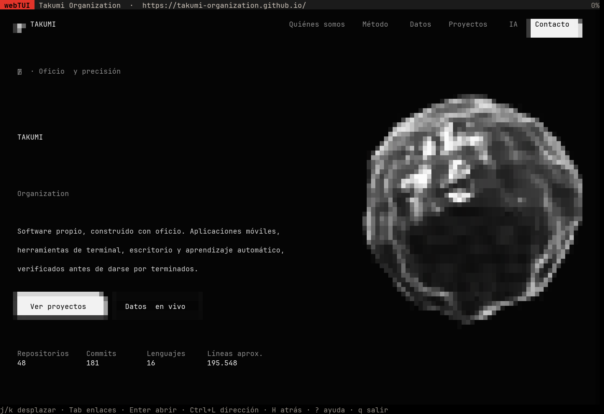
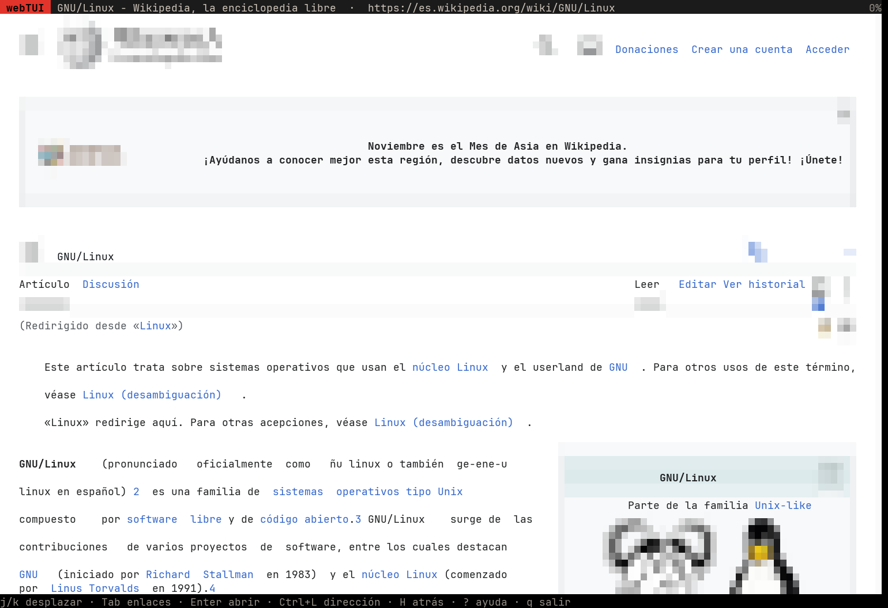
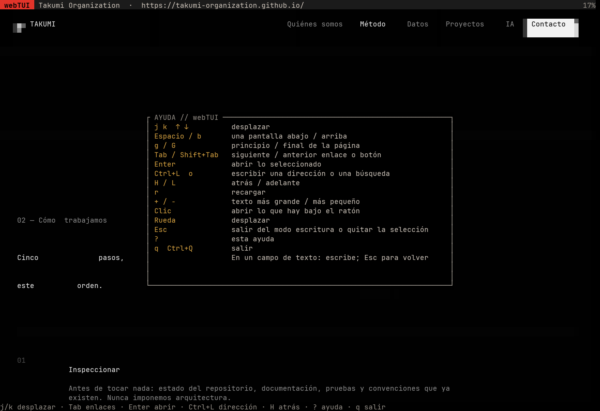

# webTUI

Navegador para el terminal. **Firefox (sin cabeza) es el motor**, así que funciona con
cualquier página, también las dinámicas (JavaScript, SPAs, temporizadores); la pantalla es una
rejilla de celdas de color: los **colores y las imágenes** salen de una captura de la página y el
**texto** se dibuja como texto, en su sitio y con su color. Pensado para
TUI-OS, el sistema operativo de texto de la organización (donde sustituirá a Browsh) pero funciona en cualquier terminal con truecolor
(kitty, WezTerm, foot, Alacritty…).

| | |
|---|---|
|  |  |



*Capturas reales de la aplicación (140 columnas, kitty/tmux, Zen como motor). Izquierda: [la web de la organización](https://takumi-organization.github.io/), con su objeto 3D convertido a celdas. Derecha: el artículo [GNU/Linux de Wikipedia](https://es.wikipedia.org/wiki/GNU/Linux) (texto bajo CC BY-SA 4.0). Se aprecia el límite descrito abajo: el texto es nítido, las imágenes salen pixeladas.*

```sh
cargo run --release -- https://es.wikipedia.org/wiki/Linux
cargo run --release -- archivo.html      # un archivo local
cargo run --release                      # pide una dirección
```

Necesita `firefox` en el `PATH` (o `WEBTUI_FIREFOX=/ruta/al/navegador`; vale cualquier navegador basado en Gecko con Marionette, por ejemplo Zen). Cada ejecución usa un
perfil temporal y privado que se borra al salir (cookies y sesiones no se conservan).

## Teclas

| Tecla | Acción |
|---|---|
| `j` `k` / `↑` `↓`, rueda | desplazar |
| `Espacio` / `b`, `g` / `G` | una pantalla, principio / final |
| `Tab` / `Shift+Tab` | siguiente / anterior enlace, botón o campo (se resalta y se ve su destino) |
| `Enter` | abrir lo seleccionado; en un campo de texto pasa al modo escritura (`Esc` vuelve) |
| `Ctrl+L` / `o` | escribir una dirección, un dominio, una ruta o una búsqueda (DuckDuckGo) |
| `H` / `L` | atrás / adelante · `r` recargar |
| `+` / `-` | texto más grande / pequeño |
| clic | abre lo que hay bajo el ratón |
| `?` | ayuda · `q` / `Ctrl+Q` salir |

## Cómo funciona

1. Un hilo lanza Firefox con un perfil temporal y habla con él por **Marionette** (TCP + JSON).
2. Con un script recoge cada palabra visible (posición, color, enlace), los elementos clicables y la
   altura de la página. Una palabra tapada por otro elemento (diapositivas apiladas, ventanas
   modales) o recortada (enlaces «solo para lectores») se descarta.
3. Oculta el texto con CSS y captura la ventana: solo quedan fondos, bordes e imágenes.
4. Convierte la captura en celdas: `▀` con el color de la mitad de arriba y de abajo (o un color
   plano). El texto real va encima, de izquierda a derecha, sin pisarse y con contraste legible.
5. El ancho de celda se ajusta una vez al ancho real de letra de la página.
6. **Páginas dinámicas:** un `MutationObserver` cuenta los cambios del DOM; cuando algo cambia
   solo (temporizadores, contenido cargado tarde, un SPA) se hace otra captura, como máximo dos por
   segundo. Las acciones (clic, tecla, desplazar) esperan a que la página se asiente.

Los enlaces `target="_blank"` abren la pestaña nueva y es esa la que se muestra; los diálogos
`alert/confirm` se descartan solos.

## Límites conocidos

- Las animaciones CSS y el vídeo no cambian el DOM: no provocan refresco (próximo paso: refresco
  periódico opcional).
- El espaciado vertical entre líneas es irregular: las líneas de una web miden ~22 px y las filas 16.
- Las listas desplegables (`<select>`) no se abren; no hay búsqueda en la página, pestañas
  visibles, marcadores ni descargas.
- La fidelidad está limitada por la rejilla: dos píxeles por celda. Las fotos salen pixeladas;
  el texto pequeño solo es legible porque se dibuja como texto.
- Firefox sin cabeza tarda 2-3 s en arrancar y cada captura ~0,3-0,5 s.

## Desarrollo

```sh
cargo fmt --check && cargo clippy --all-targets -- -D warnings && cargo test
```

`tests/e2e.rs` usa un Firefox real con páginas locales (y se omite si no hay Firefox): colores,
desplazamiento, clic en un enlace, atrás, escribir en un campo, una página que cambia sola, una
pestaña nueva, oclusión y redimensionado. Los módulos `render`, `page`, `url`, `app` y `marionette`
se prueban sin Firefox (la parte de Marionette contra un servidor falso).

| Módulo | Qué hace |
|---|---|
| `marionette.rs` | cliente del protocolo de Firefox |
| `firefox.rs` | lanza el Firefox privado; limpia perfiles huérfanos |
| `browser.rs` | hilo que posee Firefox: capturas, acciones, refresco automático |
| `page.rs` | modelo de la página y scripts de recogida |
| `render.rs` | de la captura y las palabras a celdas |
| `app.rs` | teclas, ratón y dibujo con Ratatui |
| `url.rs` | de lo que se escribe a una URL o una búsqueda |

## Estado

Versión 0.1. En esta revisión se comprobó: `cargo fmt --check`, `cargo clippy -D warnings`, 36 pruebas unitarias y la prueba extremo a extremo
(`tests/e2e.rs`: renderiza, desplaza, hace clic, escribe y sigue páginas dinámicas) con **Zen** como motor, en Linux.
La prueba e2e se omite sola si no hay navegador disponible; para ejecutarla con otro: `WEBTUI_FIREFOX=/ruta/al/navegador cargo test --test e2e`.
No se ha probado con Firefox propiamente dicho en esta revisión ni en la consola de Linux (TTY).

## Licencia

[MIT](LICENSE).
